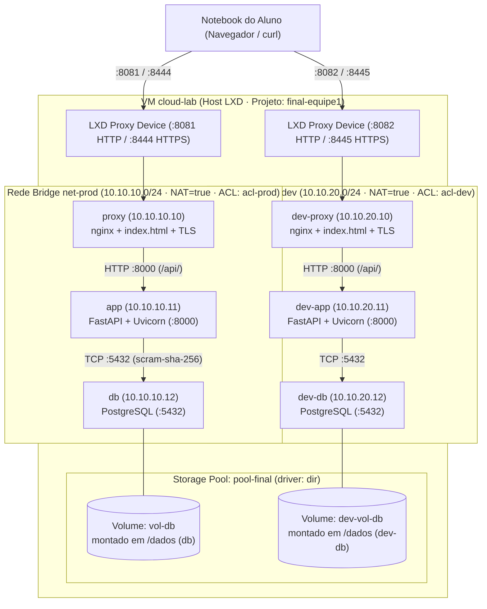

# Relatório Técnico · Nuvem Privada com LXD/Incus
**Disciplina:** Cloud Computing · **Curso:** Análise e Desenvolvimento de Sistemas (UNINASSAU)  
**Projeto:** `final-equipe1` · **Trilha B:** API de Tarefas (FastAPI) + PostgreSQL

---

## 1. Arquitetura

A solução implementa uma infraestrutura de nuvem privada baseada em **LXD/Incus** sobre o host Linux `cloud-lab`, isolando ambientes de Produção (`net-prod`) e Desenvolvimento (`net-dev`) com uma arquitetura em três camadas (Proxy Reverso/Frontend, Aplicação/API e Banco de Dados Relacional) e armazenamento persistente desacoplado (`pool-final`).

### Resumo dos Componentes
| Camada | Instância (PROD / DEV) | IP (PROD / DEV) | Perfil Aplicado | Limites | Volumes e Portas Expostas |
| :--- | :--- | :--- | :--- | :--- | :--- |
| **Proxy / Web** | `proxy` / `dev-proxy` | `10.10.10.10` / `10.10.20.10` | `perfil-base` + `perfil-proxy` | 1 vCPU, 512 MiB | Sem volume extra; expõe `:8081`/`:8444` (PROD) e `:8082`/`:8445` (DEV) via LXD `proxy` device |
| **Aplicação** | `app` / `dev-app` | `10.10.10.11` / `10.10.20.11` | `perfil-base` + `perfil-app` | 1 vCPU, 512 MiB | Sem volume extra (stateless); escuta apenas internamente em `:8000` |
| **Banco de Dados** | `db` / `dev-db` | `10.10.10.12` / `10.10.20.12` | `perfil-base` + `perfil-db` | 1 vCPU, 1 GiB | Volume `vol-db` (`dev-vol-db`) montado em `/dados`; escuta apenas internamente em `:5432` |

---

## 2. Decisões de Projeto

1. **Containers de Sistema vs. VMs Leves (QEMU/KVM):**
   - Na Fase 0.2, verificou-se a disponibilidade de `/dev/kvm`. Como a VM `cloud-lab` executa sobre o VirtualBox sem virtualização aninhada (`Nested VT-x/AMD-V: disabled`), `/dev/kvm` não está presente no host convidado.
   - Todas as três camadas (`proxy`, `app`, `db`) foram implementadas como **containers de sistema LXD**. Containers de sistema compartilham o kernel Linux do host (via *namespaces* e *cgroups* v2), proporcionando inicialização em poucos segundos, baixíssimo overhead de memória (três camadas rodando simultaneamente em menos de 1,2 GiB de RAM) e isolamento completo de processos e rede.
2. **Driver `dir` no Storage Pool (`pool-final`):**
   - O driver `dir` armazena discos raiz e volumes customizados diretamente em subdiretórios do sistema de arquivos ext4 do host (`/var/snap/lxd/common/lxd/storage-pools/pool-final`).
   - Foi escolhido por funcionar universalmente em qualquer VM sem exigir discos ou partições dedicadas (como ZFS ou Btrfs em bloco bruto), mantendo suporte nativo a volumes independentes (`vol-db`), snapshots de instância/volume e exportação para tarball (`tar.gz`).
3. **Desenho das Redes, IP Estático e Isolamento por ACL:**
   - Foram criadas duas bridges gerenciadas pelo LXD: `net-prod` (`10.10.10.0/24`) e `net-dev` (`10.10.20.0/24`), ambas com `ipv4.nat=true` para permitir que as instâncias baixem pacotes via `cloud-init` sem ficarem expostas diretamente à rede externa.
   - A atribuição de IPs fixos via `lxc config device override <instancia> eth0 ipv4.address=<IP>` garante determinismo na comunicação entre `nginx` → `uvicorn` (`.11:8000`) e `uvicorn` → `postgresql` (`.12:5432`), além de permitir que o `pg_hba.conf` restrinja conexões exclusivamente ao IP `.11/32` da camada `app`.
   - Como o kernel do host roteia pacotes entre bridges locais por padrão, aplicaram-se as Network ACLs `acl-prod` e `acl-dev` bloqueando (`action=drop`) todo tráfego de entrada e saída cruzado entre `10.10.10.0/24` e `10.10.20.0/24`, com política padrão `allow` para preservar a conectividade interna e o NAT de saída para a internet.

---

## 3. Comparação: LXD/Incus vs. OpenStack vs. Apache CloudStack

| Conceito / Funcionalidade no Projeto | Implementação no LXD / Incus | Equivalente no OpenStack | Equivalente no Apache CloudStack |
| :--- | :--- | :--- | :--- |
| **Computação (Instâncias e Limites)** | Containers de sistema e VMs (`lxc init`/`launch`) + `limits.cpu` / `limits.memory` nos *Profiles* | **Nova** (Compute) + *Flavors* (definição de vCPU, RAM e disco raiz) | **Compute Offerings** + Virtual Machines / Containers (KVM/LXC) |
| **Imagens de Sistema Operacional** | Repositório de imagens (`ubuntu:24.04`) com cache local compartilhado | **Glance** (Image Service) | **Templates & ISOs** (armazenados no Secondary Storage) |
| **Redes Virtuais e NAT** | Bridges gerenciadas (`lxc network create net-prod` com `ipv4.nat=true`) | **Neutron** (Virtual Networks, Subnets e Virtual Routers com SNAT) | **Isolated Guest Networks** / VPC Tiers suportados por Virtual Router |
| **Isolamento e Firewall de Rede** | **LXD Network ACLs** (`acl-prod`, `acl-dev`) + regras ingress/egress | **Neutron Security Groups** e Firewall-as-a-Service (FWaaS) | **Security Groups** / **Network ACL Lists** (em VPCs) |
| **Exposição de Portas Externas** | Dispositivo `proxy` do LXD (`listen=tcp:0.0.0.0:8081 connect=tcp:127.0.0.1:80`) | **Neutron Floating IPs** (DNAT) ou **Octavia** (Load Balancer) | **Port Forwarding Rules** / Static NAT no Public IP do Virtual Router |
| **Armazenamento Persistente (Blocos/Volumes)** | **LXD Storage Pools & Custom Volumes** (`pool-final`, `vol-db`, snapshots e exports) | **Cinder** (Block Storage Volumes e Volume Snapshots) | **Data Disks / Volumes** no Primary Storage + Volume Snapshots |
| **Multi-tenancy, Projetos e RBAC** | **LXD Projects** (`final-equipe1`) + Certificados TLS restritos (`--restricted --projects`) | **Keystone** (Identity Service: Projects/Tenants, Users, Roles) | **Domains, Accounts & Projects** com papéis (Root Admin, Domain Admin, User) |
| **Automação no Boot e Orquestração** | `cloud-init.user-data` nos *Profiles* + `scripts/deploy.sh` | **cloud-init** via Nova Metadata Service + **Heat** (Orchestration) / Terraform | **cloud-init** via Virtual Router User-Data + Terraform / CloudStack API |
| **Telemetria e Monitoramento** | `lxc list -c ns4mDu`, `lxc info --resources` e endpoint `/1.0/metrics` (OpenMetrics) | **Ceilometer** / **Gnocchi** / **Monasca** | **CloudStack Usage Server** + métricas de Host/VM na UI/API |

---

## 4. Evidências por Fase

Todas as saídas completas encontram-se arquivadas em `docs/evidencias/`. Abaixo estão os registros consolidados de cada fase:

- **Fase 0 (Preparação e Teste KVM):**
  - `docs/evidencias/fase0-ambiente.txt`: Saída de `lxc version`, `free -h`, `df -h /` e listagem do projeto `final-equipe1`.
  - `docs/evidencias/fase0-kvm.txt`: Saída de `ls -l /dev/kvm` e tentativa de `lxc launch ubuntu:24.04 vm-teste --vm`, documentando a ausência de virtualização aninhada no VirtualBox e a decisão de seguir com containers de sistema.
- **Fase 1 (Rede e Storage):**
  - `docs/evidencias/fase1-redes.txt`: Saída de `lxc network list`, `lxc network show net-prod` e `ip -br addr show net-prod`.
  - `docs/evidencias/fase1-storage.txt`: Saída de `lxc storage info pool-final` e `lxc storage volume list pool-final`.
- **Fase 2 e 3B (Perfis, Implantação da API + PostgreSQL e Persistência):**
  - `docs/evidencias/fase3-banco-api.txt`: Saída de `ss -tlnp | grep 5432` no container `db`, `curl -s http://localhost:8000/api/saude` no container `app`, e `curl -s http://127.0.0.1:8081/api/tarefas` passando pelo `proxy`.
  - `docs/evidencias/antes.json`, `docs/evidencias/depois.json` e `docs/evidencias/fase3-persistencia.txt`: Comprovação de que após `lxc delete -f db` e recriação da instância anexando o mesmo volume `vol-db`, o `diff antes.json depois.json` retorna `DADOS PRESERVADOS`.
- **Fase 4 (Isolamento e Exposição):**
  - `docs/evidencias/fase4-portas.txt`: Comprovação via `lxc config device list` e `ss -tlnp` de que apenas as portas do proxy (`8081`/`8444`) estão expostas no host, enquanto a porta `5432` do PostgreSQL permanece inacessível externamente.
  - `docs/evidencias/fase4-isolamento-acl.txt`: Comparação lado a lado do teste a partir de `teste-dev` (`net-dev`) para `10.10.10.12:5432` (`net-prod`): resultado `ALCANCOU` antes da ACL e `BLOQUEADO` após aplicar `acl-prod` e `acl-dev`, mantendo saída HTTP para a internet e resposta normal do serviço, seguido de `lxc network acl show acl-prod`.
- **Fase 5 (Acesso Admin/Operador e TLS):**
  - `docs/evidencias/fase5-acesso.txt`: Saída de `lxc config trust list`, sucesso em `lxc list operador: --project final-equipe1` e erro de permissão negada em `lxc list operador: --project default`.
  - `docs/evidencias/fase5-tls.txt`: Saída de `curl --cacert conf/tls/ca.crt --resolve servico.lab:8444:127.0.0.1 -sI https://servico.lab:8444` (`HTTP/1.1 200 OK`) e inspeção do certificado X.509 (`openssl x509 -in conf/tls/servico.crt -noout -text | head -20`).
- **Fase 6 (Snapshots e Backup):**
  - `docs/evidencias/fase6-snapshots-backup.txt`: Listagem dos snapshots `snap-instancia` e `snap-volume`, registro das tarefas antes do desastre, lista vazia (`[]`) após `DELETE` de todas as tarefas, e restauração completa após `lxc stop db && lxc storage volume restore pool-final vol-db snap-volume && lxc start db`, além da exportação e importação de `db.tar.gz` e `vol-db.tar.gz`.
- **Fase 7 (Automação Reproduzível):**
  - `docs/evidencias/fase7-reprodutibilidade.txt`: Execução de `deploy.sh` para `ENV=prod` e `ENV=dev` e saída de `lxc list` exibindo as 6 instâncias (`proxy`, `app`, `db`, `dev-proxy`, `dev-app`, `dev-db`) rodando simultaneamente.
- **Fase 8 (Monitoramento e Limites):**
  - `docs/evidencias/fase8-monitoramento.txt`: Captura do painel `scripts/monitor.sh`, saída de `nproc` (`1`) e `free -m` (`512 MiB`) em `app`, e evolução do contador `CPU USAGE` durante o teste de estresse de 20 segundos (`timeout 20 sh -c 'yes > /dev/null'`), demonstrando que o consumo de CPU subiu apenas na instância `app` limitada a 1 núcleo lógico.

---

## 5. Operação

### 5.1 Reprodução Automatizada do Ambiente
O script `scripts/deploy.sh` reconstrói toda a infraestrutura de forma idempotente:
1. Verifica/cria o projeto LXD `final-equipe1` e alterna para ele (`lxc project switch`).
2. Cria a rede bridge (`net-prod` ou `net-dev`), o storage pool `pool-final` e o volume `${PREFIXO}vol-db`.
3. Atualiza os quatro perfis (`perfil-base`, `perfil-proxy`, `perfil-app`, `perfil-db`) a partir de `profiles/*.yaml`.
4. Gera a Autoridade Certificadora (`ca.crt`) e o certificado TLS (`servico.crt`) com `SubjectAltName` para `servico.lab` e o IP da VM, caso ainda não existam em `conf/tls/`.
5. Provisiona e configura em sequência: `db` (PostgreSQL com dados em `/dados/pgdata`), `app` (FastAPI em `/opt/api/venv` gerenciado via `systemd`) e `proxy` (Nginx com redirecionamento HTTP → HTTPS e proxy reverso para `/api/`).

### 5.2 Procedimento de Restauração em Caso de Desastre
1. Parar o container do banco de dados: `lxc stop db` (imprescindível para fechar os descritores de arquivo do PostgreSQL e evitar corrupção do WAL).
2. Restaurar o snapshot do volume: `lxc storage volume restore pool-final vol-db snap-volume`.
3. Iniciar novamente o container do banco: `lxc start db`.
4. Caso a perda envolva a VM inteira ou o pool local, importar os artefatos exportados em `~/backup`:
   - `lxc import ~/backup/db.tar.gz db-restaurado`
   - `lxc storage volume import pool-final ~/backup/vol-db.tar.gz vol-db-restaurado`
5. Validar o endpoint `/api/tarefas` via `curl` ou navegador.

---

## 6. Limitações e Melhorias Futuras

1. **Alta Disponibilidade (HA) e Clusterização:**
   - Atualmente, toda a topologia roda em um único nó LXD (`cloud-lab`) e com instâncias únicas por camada. Em produção real, recomenda-se formar um **cluster LXD/Incus** (mínimo 3 nós com banco Dqlite distribuído), múltiplas réplicas da camada `app` (FastAPI é *stateless*) balanceadas pelo Nginx, e replicação *streaming* (Primary/Replica) no PostgreSQL.
2. **Backend de Armazenamento:**
   - O driver `dir` não possui *Copy-on-Write* (CoW) nem cotas rígidas de bloco por volume sem suporte do filesystem subjacente. Em produção, a migração do pool para **ZFS**, **Btrfs** ou **Ceph RBD** (em cluster) permitiria snapshots instantâneos sem cópia integral de arquivos e controle estrito de IOPS/quota.
3. **Gestão de Segredos:**
   - Embora `.gitignore` impeça o versionamento de `*.key` e `*.env` e a senha seja parametrizada via variável de ambiente (`DB_PASS`), uma arquitetura corporativa utilizaria **HashiCorp Vault** ou injeção segura de segredos via pipeline CI/CD com rotação automática de credenciais.
4. **Observabilidade Avançada:**
   - O endpoint `/1.0/metrics` do LXD já exporta métricas no formato OpenMetrics. O próximo passo natural é conectar um servidor **Prometheus** para coleta contínua e **Grafana** para dashboards históricos e alertas de saturação de CPU/memória/disco.

---

## 7. Roteiro de Apoio para a Demonstração (15 Minutos · Fase 9.3)

| Tempo | Etapa | Comandos Prontos para Execução ao Vivo |
| :--- | :--- | :--- |
| **0 a 2 min** | Arquitetura e instâncias | `lxc project switch final-equipe1 && lxc list` |
| **2 a 5 min** | Serviço HTTPS funcionando | `curl --cacert conf/tls/ca.crt --resolve servico.lab:8444:127.0.0.1 -i https://servico.lab:8444/api/tarefas` (e abrir `https://<IP-DA-VM>:8444` no navegador) |
| **5 a 8 min** | Derrubar banco e provar persistência | `lxc delete -f db && lxc list && lxc storage volume list pool-final`   `lxc init ubuntu:24.04 db -p perfil-base -p perfil-db && lxc config device override db eth0 ipv4.address=10.10.10.12 && lxc config device add db dados disk pool=pool-final source=vol-db path=/dados && lxc start db && lxc exec db -- cloud-init status --wait && lxc file push conf/config-postgres.sh db/root/config-postgres.sh && lxc exec db -- bash /root/config-postgres.sh 10.10.10.11 tarefas apiuser Equipe1Pass2026`   `curl -k https://127.0.0.1:8444/api/tarefas` |
| **8 a 11 min** | Simular desastre e restaurar snapshot | `lxc storage volume snapshot pool-final vol-db snap-demo`   `for id in 1 2 3; do curl -k -X DELETE https://127.0.0.1:8444/api/tarefas/$id; done && curl -k https://127.0.0.1:8444/api/tarefas`   `lxc stop db && lxc storage volume restore pool-final vol-db snap-demo && lxc start db && sleep 2 && curl -k https://127.0.0.1:8444/api/tarefas` |
| **11 a 13 min** | Isolamento de rede (DEV x PROD) | `lxc network acl show acl-prod`   `lxc exec dev-app -- bash -c 'timeout 3 bash -c "echo > /dev/tcp/10.10.10.12/5432" && echo ALCANCOU || echo BLOQUEADO'` |
| **13 a 15 min** | Automação e monitoramento | `head -n 45 scripts/deploy.sh`   `./scripts/monitor.sh` |
